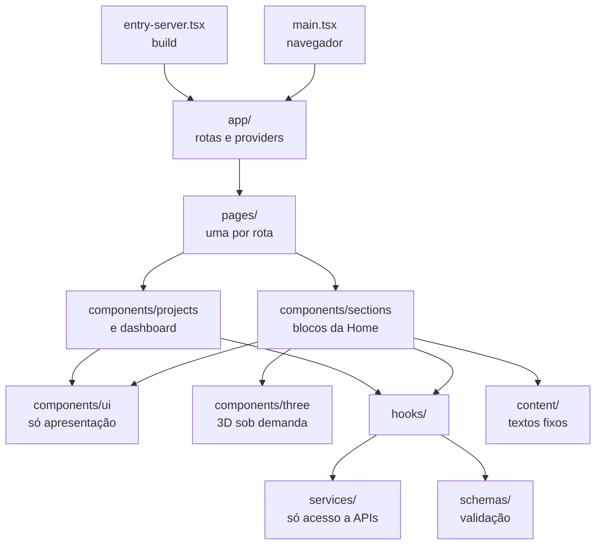
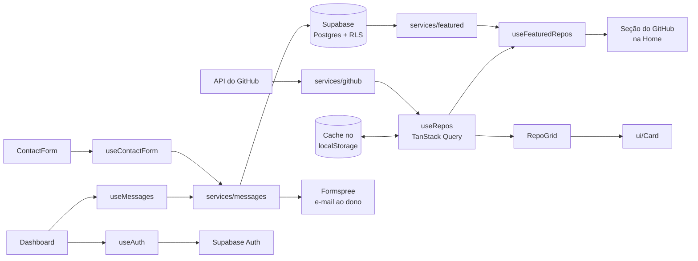
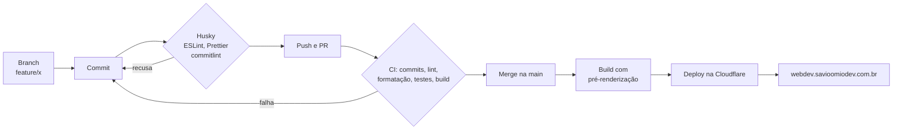
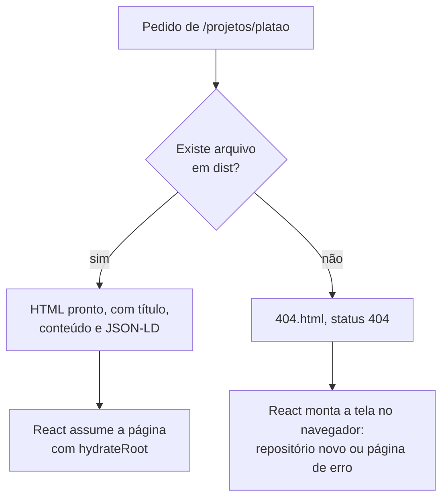

# Diagramas

Usados na parte 1 do vídeo. O GitHub desenha os blocos Mermaid direto nesta página.

## Pastas

Critério de divisão: `ui` não sabe de regra de negócio, `sections` e `pages` montam a tela, `hooks` guardam a lógica e `services` são os únicos que falam com APIs.

## Fluxo de dados

## Da branch ao deploy

## Como uma página chega ao navegador

