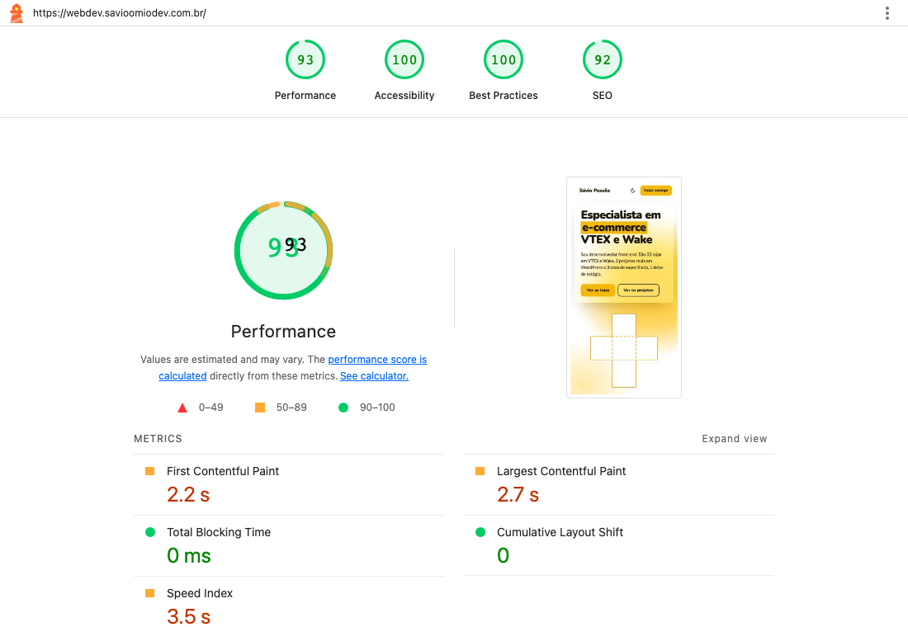

# Performance

Medido em 31/10/2026 no site publicado, depois das correções do PR #25.

## PageSpeed Insights

| Página | Dispositivo | Desempenho | Acessibilidade | Boas práticas | SEO | LCP | TBT | CLS |
| --- | --- | --- | --- | --- | --- | --- | --- | --- |
| [`/`](https://pagespeed.web.dev/analysis/https-webdev-savioomiodev-com-br/3wyab4bu8j?form_factor=mobile) | Celular | 100 | 100 | 100 | 100 | 1,0 s | 0 ms | 0 |
| [`/`](https://pagespeed.web.dev/analysis/https-webdev-savioomiodev-com-br/low5ywbxoz?form_factor=desktop) | Desktop | 100 | 100 | 100 | 100 | 0,3 s | 0 ms | 0 |
| [`/projetos`](https://pagespeed.web.dev/analysis/https-webdev-savioomiodev-com-br-projetos/y3fil69p5s?form_factor=mobile) | Celular | 100 | 100 | 100 | 100 | 0,9 s | 0 ms | 0 |
| `/projetos/mao-robotica` | Celular | 100 | 100 | 100 | 100 | 1,5 s | 0 ms | 0 |
| `/projetos/gasmaster` | Celular | 99 | 100 | 100 | 100 | 2,3 s | 0 ms | 0 |

O requisito 8 pede nota mínima de 80 em performance no mobile.

Antes do PR #25, a Home marcava 98 no celular e **70 no desktop**, com TBT de 11 s, e a página da mão tinha CLS de 0,145.

O print acima é do Lighthouse 12 rodado por nós, antes do PR #25, com nota 93. Nessa ferramenta o SEO marca 92 no domínio, porque a Cloudflare injeta no `robots.txt` uma linha `Content-Signal` que o Lighthouse local não reconhece. O PageSpeed não aponta esse item.

## O que a nota não mostra

O PageSpeed e o Lighthouse não fazem gestos, então medem a página antes de o 3D entrar. Para ver o uso real, medimos a Home com CPU 4x mais lenta, rede 4G lenta e GPU em software, que é o pior caso:

| Momento | Resultado |
| --- | --- |
| Download até a página abrir | 214 kB |
| Do gesto até o 3D pronto | 1,6 s, com um travamento de 0,6 s |
| Rolagem nas lojas, com o 3D | 42 quadros por segundo |
| Trilho horizontal | 30 quadros por segundo |
| Total ao percorrer a página inteira | 1,9 MB, sendo 0,9 MB de vídeo |

Com GPU de verdade, como num celular, a tendência é ser melhor. **Não foi testado em aparelho físico.**

## O que mudou as notas

- O 3D só baixa no primeiro gesto, com um desenho estático da folha até lá.
- Posters dos vídeos e formulário só carregam quando chegam perto.
- Cada rota sai pronta no build, com o CSS dentro do HTML.
- A página da rota carrega antes de hidratar, então o React não descarta o HTML.
- Imagens e vídeos das páginas de projeto reservam o próprio espaço.
